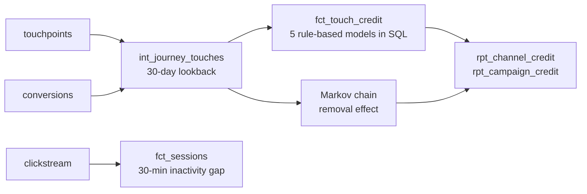

# attribution-lab

Clickstream sessionization and **multi-touch marketing attribution** on DuckDB, for a subscription streaming service.

It answers the question every marketing team asks after a big live event: *which channels and campaigns actually drove the sign-ups?* It answers it six ways, side by side, because the right model is a business decision and seeing the spread between models is the useful part.


## What it does



1. **Sessionize clickstream** with window functions: a new session starts after 30 minutes of inactivity.
2. **Build conversion journeys**: every touch in the 30 days before a sign-up, with its position in the path.
3. **Rule-based credit in SQL**: first-touch, last-touch, linear, time-decay (7-day half-life) and position-based (40/20/40).
4. **Data-driven credit**: a first-order Markov chain over *all* user paths, including users who never converted, scored by removal effect.
5. **Reporting tables** at channel and campaign level, including live-event promo campaigns.

## Example output

On the bundled synthetic dataset (20,000 users, ~80K touchpoints, ~200K page views, 2,849 sign-ups):

| channel | first_touch | last_touch | linear | time_decay | position_based | markov |
|---|---:|---:|---:|---:|---:|---:|
| paid_search | 726.0 | 706.0 | 703.4 | 700.4 | 710.4 | 576.6 |
| paid_social | 577.0 | 598.0 | 581.1 | 581.9 | 585.1 | 529.3 |
| organic | 443.0 | 480.0 | 463.2 | 465.6 | 463.7 | 485.4 |
| display | 363.0 | 349.0 | 357.6 | 357.6 | 355.4 | 405.8 |
| email | 351.0 | 331.0 | 348.4 | 348.1 | 343.6 | 368.8 |
| ctv | 215.0 | 234.0 | 234.4 | 234.7 | 229.3 | 275.8 |
| affiliate | 174.0 | 151.0 | 160.9 | 160.7 | 161.5 | 207.4 |

The Markov model moves credit away from high-volume search toward assisting channels such as CTV and display. That is the kind of gap worth taking to a marketing team before they cut an upper-funnel budget.

## Run it

```bash
pip install -r requirements.txt
python generate_data.py --users 20000 --out data
python attribution.py --data data --db attribution.duckdb
pytest -q
```

Runs in about a second on a laptop.

## Design notes

- **Every model conserves conversions.** Tests check that credit sums to exactly one per conversion for each rule-based model, and to total conversions for Markov.
- **Lookback is enforced in the join**, not after it, so stale touches never enter a journey.
- **Non-converting paths are part of the Markov model.** Leaving them out is a common mistake that makes every channel look like it converts.
- **Absorption probabilities are solved exactly** with `(I - Q)x = R` instead of simulating random walks, so results are deterministic.
- **SQL-first.** The transformations are plain DuckDB SQL with window functions and port directly to BigQuery or Snowflake.

## Going to production

| Concern | Here | At scale |
|---|---|---|
| Storage | Parquet + DuckDB | BigQuery, partitioned by event date, clustered by user |
| Orchestration | CLI | Airflow DAG: sessionize → journeys → credit, daily with backfills |
| Identity | `user_id` given | Identity graph stitching device, cookie and account IDs |
| Late data | none | Re-score a rolling 30-day window each day (idempotent overwrite by partition) |
| Validation | unit tests | Conversion-conservation checks as data tests on every run |

## Data

All data is synthetic and generated by `generate_data.py`. It includes two live-event promo campaigns whose touches cluster in the five days before the event.
